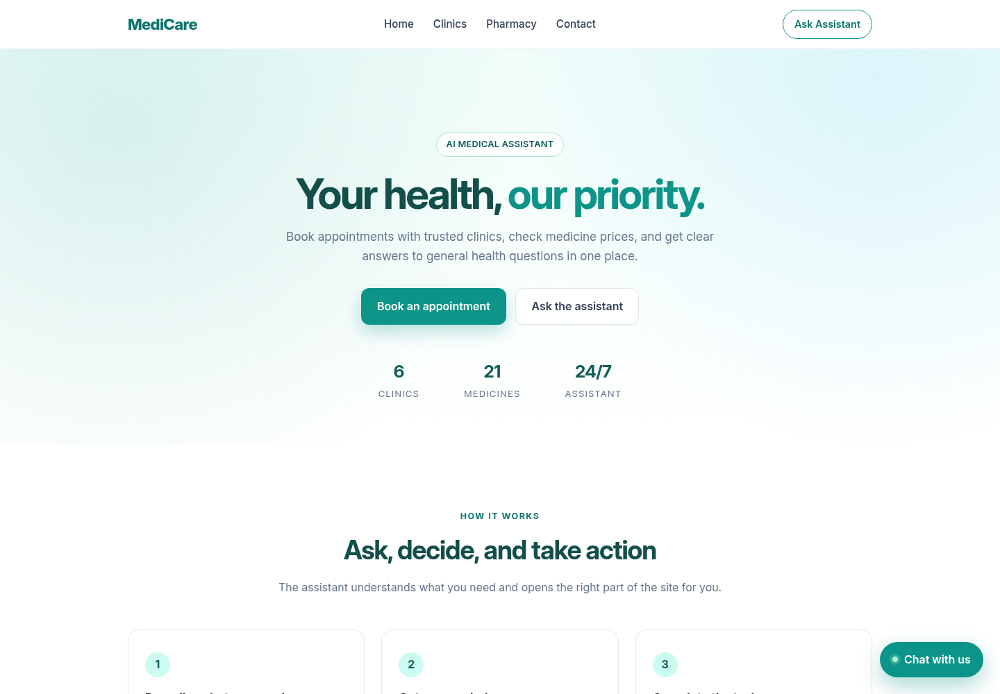
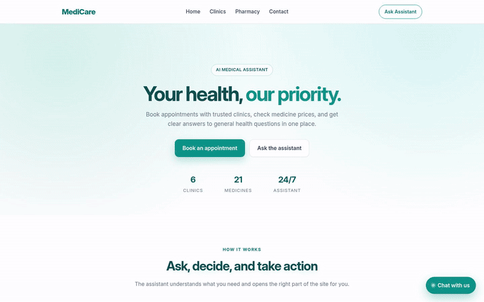
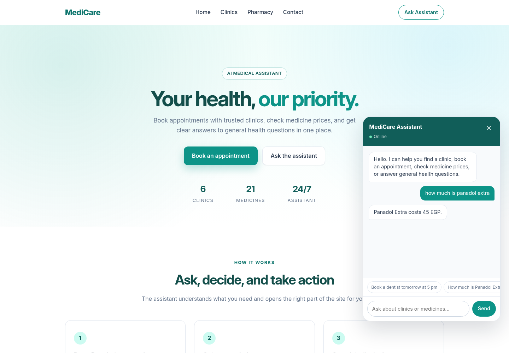
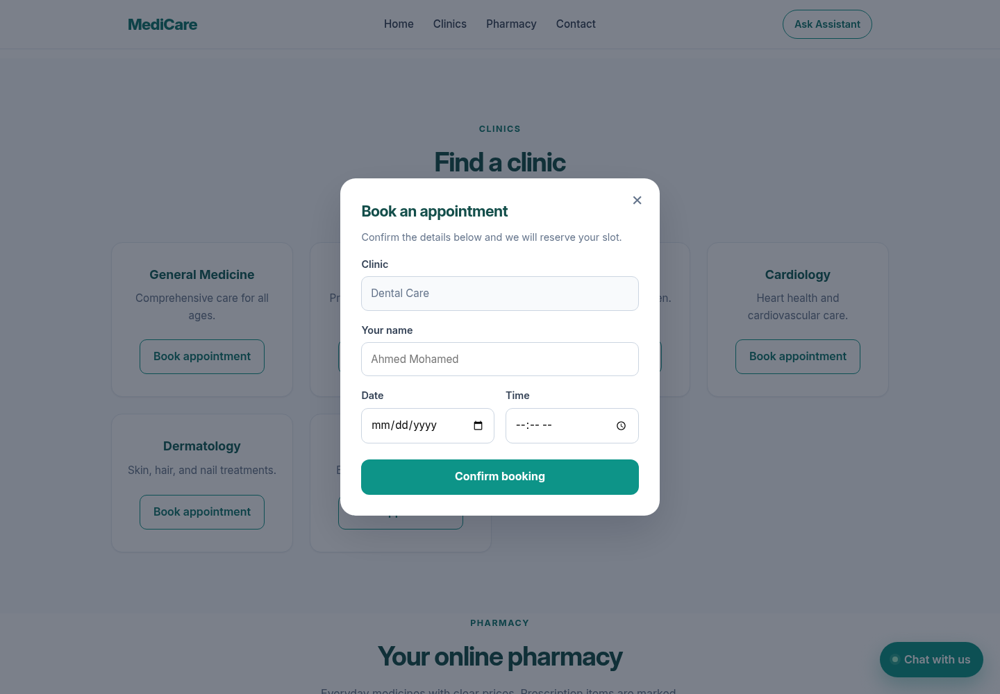
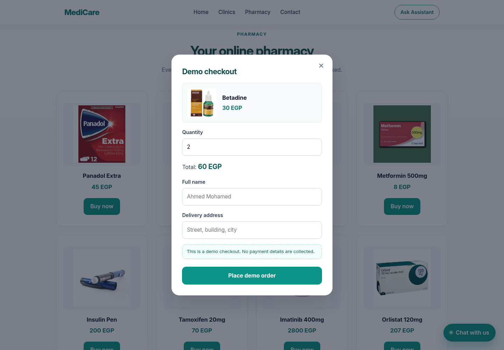
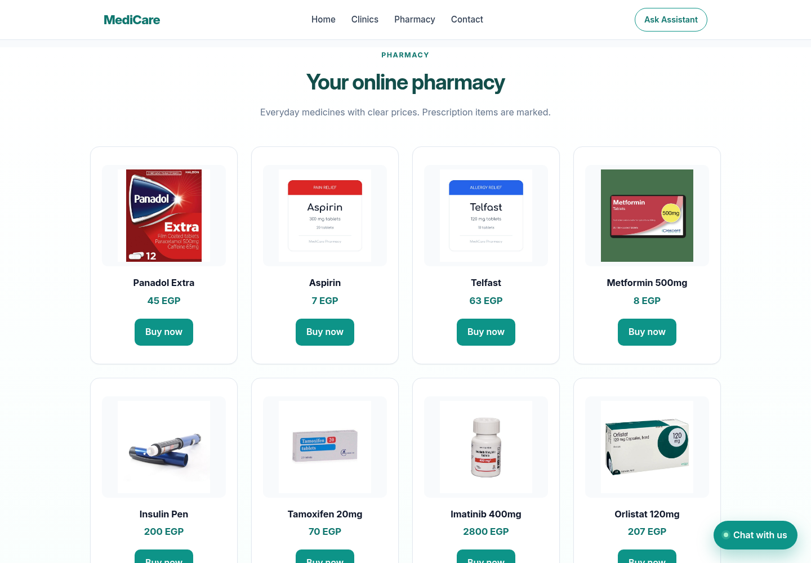
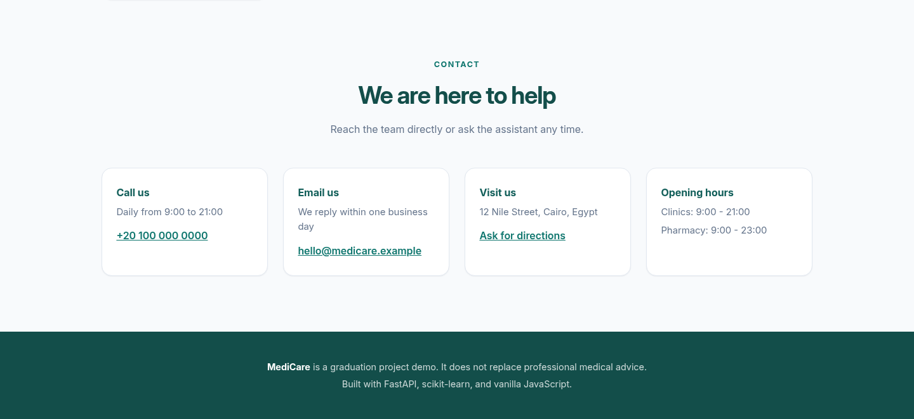
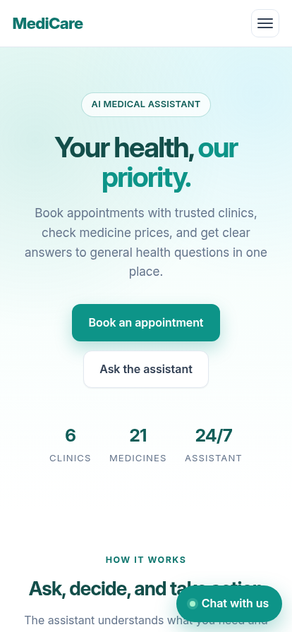

# MediCare Assistant

A small medical web assistant that answers questions **and performs the matching interface action**.
Ask for a dentist and the booking form opens with the clinic, name, date, and time already filled in.
Ask for a medicine price and the pharmacy card is highlighted. Ask a general health question and the
answer is grounded in a curated knowledge base plus a MedlinePlus summary when available.

The app runs without a GPU, without a vector database, and without an API key. It is built with
FastAPI, scikit-learn, and vanilla JavaScript, and it ships with 76 automated tests.

[](https://www.python.org/)
[](https://fastapi.tiangolo.com/)
[](#testing)
[](#frontend)



## Demo

The 19-second recording below shows a price question, a booking created from chat, a demo checkout,
and a grounded medical answer.



[Watch the MP4 version](demo/medicare-demo.mp4)

## What it does

- **Book an appointment from a sentence.** "Book a dentist for Ahmed tomorrow at 5 pm" opens the
  booking form with Dental Care, Ahmed, the correct date, and 17:00 already selected.
- **Buy a medicine from a sentence.** "Buy two packs of Betadine for Ali" opens a demo checkout with
  the medicine, price, quantity, and name filled in.
- **Answer price, dosage, and description questions.** "How much is Panadol Extra?" returns 45 EGP
  and highlights the matching product card.
- **Ground medical questions.** "What is diabetes?" retrieves the local knowledge base, fetches a
  patient summary from MedlinePlus, shows the source link, and adds a medical disclaimer.
- **Navigate with language.** "Open the pharmacy", "show me the clinics", and "what is your phone
  number?" scroll to the relevant section.
- **Handle small talk and emergencies.** Greetings and thanks are answered normally; emergency
  phrases produce an urgent message with local emergency numbers instead of a chat reply.

This is a graduation project demo. It does not diagnose, prescribe, process payments, or reserve real
appointments. See [Limitations](#limitations).

## Screenshots

| Agentic chat | Booking from chat |
| --- | --- |
|  |  |

| Demo checkout | Pharmacy |
| --- | --- |
|  |  |

| Contact | Mobile |
| --- | --- |
|  |  |

## How it works

The backend classifies every chat message into one of twelve actions. Actionable actions return a
reply **and** a structured entity object. The browser uses that object to open and pre-fill the right
form. Informational actions use retrieval and optional external grounding.

| Action | Example | What the user sees |
| --- | --- | --- |
| `book_appointment` | book a dentist for Ahmed tomorrow at 5 pm | Booking modal, pre-filled |
| `buy_medicine` | buy two packs of betadine for Ali | Checkout modal, pre-filled |
| `price` | how much is Panadol Extra? | Reply and card highlight |
| `dosage` | what is the dosage of augmentin? | Reply and card highlight |
| `medicine_info` | tell me about betadine | Description, price, strength, prescription note |
| `navigate_clinics` | show me the clinics | Scrolls to clinics |
| `navigate_pharmacy` | open the pharmacy | Scrolls to pharmacy |
| `navigate_contact` | what is your phone number? | Scrolls to contact |
| `medical_question` | what is diabetes? | Grounded summary, source link, disclaimer |
| `emergency` | I have chest pain | Urgent message with emergency numbers |
| `unknown` | tell me a joke | Helpful fallback |

The full write-up, including the architecture diagram, security table, and testing notes, is in
[`docs/architecture.pdf`](docs/architecture.pdf). The source is [`docs/architecture.typ`](docs/architecture.typ)
and compiles with Typst 0.15 without any external packages.

### Request flow

```text
Browser
  -> POST /api/chat
     -> normalise and classify
     -> extract clinic / medicine / name / date / time / quantity
     -> action?  yes -> return reply + entities -> browser opens and fills a form
                 no  -> retrieve local chunks
                     -> medical question? -> MedlinePlus summary
                     -> optional LLM (disabled by default)
                     -> extractive fallback + disclaimer
```

### Why this design

- **TF-IDF retrieval** keeps the demo deterministic and deployable on a free instance. The index has
  14 heading-aware chunks, is built at startup, and is small enough to inspect by hand.
- **Rule-based intent detection** makes the agent behaviour reproducible and testable. The language
  model is an optional answer generator, not the component that decides which form to open.
- **No LLM by default** means the project works offline and never depends on a paid key. Setting
  `LLM_PROVIDER` enables Gemini, Groq, or a local Ollama model through an OpenAI-compatible endpoint.
- **Vanilla frontend** has no build step, no framework runtime, and no dependency updates.

## Tech stack

| Layer | Choice |
| --- | --- |
| API | FastAPI, Uvicorn |
| Validation and settings | Pydantic v2, pydantic-settings |
| Retrieval | scikit-learn TF-IDF, cosine similarity |
| Medical grounding | MedlinePlus Web Service (NLM), XML parsing |
| Optional generation | Gemini, Groq, or Ollama via OpenAI-compatible chat completions |
| Frontend | HTML, CSS, vanilla JavaScript modules |
| Tests | pytest, FastAPI TestClient |
| Documentation | Typst |
| Deployment | Render (`render.yaml`) |

## Quick start

Requires Python 3.12 or newer. Node is only needed if you want to syntax-check the frontend.

```bash
git clone <your-repository-url>
cd medicare-ai
python3.12 -m venv .venv
source .venv/bin/activate
pip install -r requirements.txt
cp .env.example .env
uvicorn app.main:app --reload
```

Open `http://127.0.0.1:8000`. The interactive API documentation is at
`http://127.0.0.1:8000/docs`.

### Configuration

All settings are optional. The defaults run the project without an LLM and without a key.

| Variable | Default | Purpose |
| --- | --- | --- |
| `LLM_PROVIDER` | `none` | `none`, `gemini`, `groq`, or `ollama` |
| `LLM_API_KEY` | empty | Provider key; not needed for Ollama |
| `LLM_MODEL` | provider default | Model name, for example `gemini-2.5-flash` |
| `LLM_BASE_URL` | provider default | Override the OpenAI-compatible base URL |
| `MEDLINEPLUS_ENABLED` | `true` | Enable the MedlinePlus lookup |
| `RATE_LIMIT_PER_MINUTE` | `40` | Per-IP API limit; `0` disables it |
| `FEEDBACK_PATH` | `data/feedback.jsonl` | Where feedback records are appended |

Gemini example:

```bash
LLM_PROVIDER=gemini
LLM_API_KEY=your-key
LLM_MODEL=gemini-2.5-flash
```

Local Ollama example:

```bash
LLM_PROVIDER=ollama
LLM_MODEL=llama3.2
```

If the provider is unreachable or returns an error, the backend falls back to the deterministic
extractive answer instead of failing the request.

## API

| Method | Path | Purpose |
| --- | --- | --- |
| `GET` | `/api/health` | Status, provider, and indexed chunk count |
| `GET` | `/api/catalog` | Six clinics and twenty-one medicines |
| `POST` | `/api/chat` | Intent, reply, entities, and sources |
| `POST` | `/api/agent` | Agent response without retrieval or generation |
| `POST` | `/api/feedback` | Append a correction record for offline review |

Example request:

```bash
curl -X POST http://127.0.0.1:8000/api/chat \
  -H 'Content-Type: application/json' \
  -d '{"message":"book a dentist for Ahmed tomorrow at 5 pm"}'
```

Example response:

```json
{
  "reply": "I can book an appointment at Dental Care. Fill in your details to confirm.",
  "intent": "book_appointment",
  "entities": {
    "clinic": "Dental Care",
    "description": "Professional dental services.",
    "name": "Ahmed",
    "date": "2026-11-08",
    "time": "17:00"
  },
  "sources": []
}
```

## Testing

```bash
pip install -r requirements-dev.txt
pytest
```

The suite covers intent classification, entity extraction, date and time parsing, fuzzy medicine
matching, retrieval ranking, API validation, security headers, rate limiting, feedback persistence,
catalogue consistency, local image validity, and the absence of leftover branding. Network calls are
disabled in tests; the MedlinePlus path is tested with a stub.

```text
76 passed
```

Frontend syntax check:

```bash
cp Frontend/index.js /tmp/index.mjs && node --check /tmp/index.mjs
cp Frontend/data.js /tmp/data.mjs && node --check /tmp/data.mjs
```

## Deployment

The repository includes a Render blueprint:

1. Push the repository to GitHub.
2. In Render, choose **New → Blueprint** and select the repository.
3. Apply `render.yaml`.
4. Set `LLM_PROVIDER=none` to keep the demo free, or add a provider key as a secret environment
   variable.

The blueprint uses Python 3.12, installs `requirements.txt`, starts Uvicorn on `$PORT`, and uses
`/api/health` as the health check. No database or persistent disk is required.

## Project structure

```text
medicare-ai/
├── app/
│   ├── main.py              FastAPI app, middleware, routes
│   ├── config.py            Environment settings
│   ├── schemas.py           Request and response models
│   ├── catalog.py           Six clinics, twenty-one medicines, aliases
│   ├── agent.py             Intent detection and entity extraction
│   ├── retrieval.py         Heading-aware chunking and TF-IDF index
│   ├── medical_info.py      MedlinePlus XML lookup
│   ├── llm.py               Optional OpenAI-compatible generation and fallback
│   └── knowledge/docs.md    Curated knowledge base
├── Frontend/
│   ├── index.html
│   ├── index.js             Rendering, chat, booking, checkout, navigation
│   ├── style.css
│   ├── data.js              Clinic and medicine catalogue
│   ├── fonts/
│   └── images/              Logo and local medicine photos
├── tests/                   Agent, API, retrieval, LLM, data tests
├── screenshots/             README images
├── demo/                    Demo MP4 and GIF
├── docs/                    Typst source and compiled PDF
├── requirements.txt
├── requirements-dev.txt
├── render.yaml
└── .env.example
```

## Security notes

- User and model text is rendered with `textContent`; catalogue markup is escaped.
- Messages are validated at 1–500 characters and whitespace-normalised.
- The API applies a per-IP sliding-window rate limit.
- Security headers include `nosniff`, `DENY` framing, a strict referrer policy, and a restrictive
  permissions policy.
- The Content Security Policy allows only same-origin scripts and connections, with Google Fonts
  explicitly allowed for typography. Swagger UI receives a separate CSP for its CDN assets.
- The demo checkout collects a name and address only. There are no card, CVV, or expiry fields.
- Provider keys come from environment variables and are never committed.

## Limitations

- General health information only; no diagnosis, prescription, or personalised treatment advice.
- Clinic availability and medicine prices are demo data.
- The booking confirmation does not reserve a real slot.
- The checkout is a demo and does not process payments.
- The lexical retriever handles synonyms less gracefully than a dense embedding model.
- MedlinePlus summaries are short extracts and may be incomplete or out of date.
- The knowledge base is intentionally small and focused on this demo.

## Author

Ahmad Mourad
Computer Science, 2026
[workwithahmedm@gmail.com](mailto:workwithahmedm@gmail.com)
